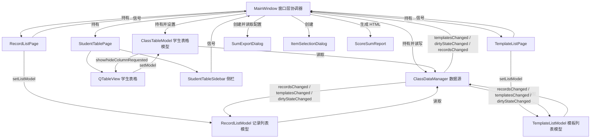
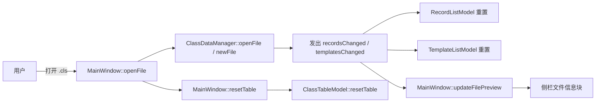
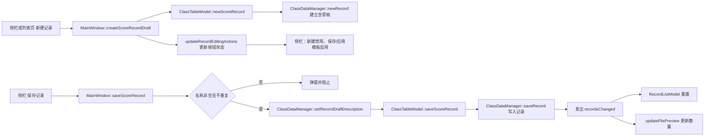
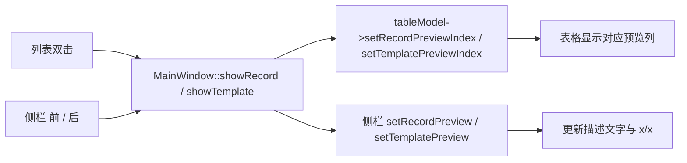
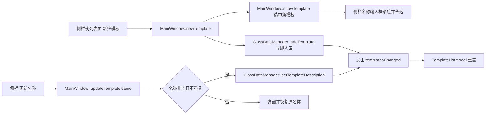
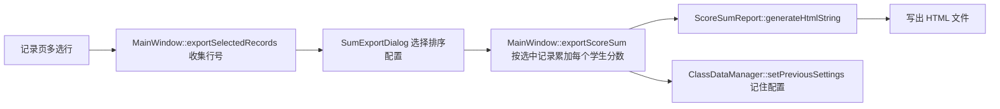

# 代码结构与数据流

## 1. 库的作用

| 库/模块 | 用途 |
|---|---|
| **Qt Core / Gui / Widgets** | 应用骨架、窗口、布局、信号槽、Model/View、拖放、对话框 |
| **FluentUI3Style** | 全局 Fluent 风格，`main.cpp` 直接 `a.setStyle(new FluentUI3Style)`，不依赖样式插件 |
| **ExWidgets** | ExWidgets 控件库；当前主要使用 `ExExpander` 实现侧栏折叠块 |
| **CMake + Ninja + MSVC x64** | 构建系统，使用 Qt 5.15.19 预设 |

## 2. 代码结构

```
src/
├── main.cpp                    # 启动入口：DPI 设置、FluentUI3Style、字体、MainWindow
├── core/                       # 数据与业务核心
│   ├── DataTypes.h             # 文件头、学生/模板/记录、排序设置及序列化
│   ├── ClassDataManager.h/.cpp # 唯一数据源：学生/模板/记录/草稿/排序设置/文件读写
│   └── ScoreSumReport.h/.cpp   # 按排序设置生成积分求和 HTML 报告
├── models/                     # Qt Model/View 模型
│   ├── ClassTableModel.h/.cpp  # 学生表格：列显隐、编辑开关、预览索引、拖拽排序
│   ├── RecordListModel.h/.cpp  # 积分记录列表模型：recordsChanged 后重置
│   └── TemplateListModel.h/.cpp# 积分模板列表模型：templatesChanged 后重置
├── pages/                      # 堆叠窗口页面（只建 UI、发信号，不含业务）
│   ├── WelcomePage.h/.cpp      # 欢迎页：打开/新建两个入口卡片
│   ├── StudentTablePage.h/.cpp # 班级表格页：左表格 + 右侧 StudentTableSidebar
│   ├── StudentTableSidebar.h/.cpp # 侧栏：文件信息/表格选项/积分记录/积分模板 4 个 ExExpander
│   ├── RecordListPage.h/.cpp   # 记录列表页：顶部工具行 + 多选列表
│   └── TemplateListPage.h/.cpp # 模板列表页：顶部工具行 + 多选列表
├── delegates/                  # 表格单元格委托
│   ├── ScoreExprDelegate.h/.cpp# 积分表达式委托
│   ├── GroupSpinBoxDelegate.h/.cpp # 小组号 SpinBox 委托
│   └── TemplateSpinBoxDelegate.h/.cpp # 模板分值 SpinBox 委托
├── widgets/                    # 自绘/复用控件
│   ├── HomeActionCard.h/.cpp   # 欢迎页操作卡片
│   ├── LineSpacedLabel.h/.cpp  # 可调节行距标签
│   └── ShineLabel.h/.cpp       # 发光标题标签
└── windows/                    # 主窗口与对话框（全部纯代码）
    ├── MainWindow.h/.cpp       # 窗口层协调器：文件/学生/关于菜单，所有页面与模型的连接
    ├── SumExportDialog.h/.cpp  # 积分导出对话框：只保留排序配置，确定/取消
    ├── ItemSelectionDialog.h/.cpp # 下拉选择对话框：删除学生、应用模板
    └── AboutInfoDialog.h/.cpp  # 关于对话框
```

## 3. 架构关系图



## 4. 数据流向图

### 4.1 打开 / 新建文件



### 4.2 新建 / 保存积分记录



### 4.3 记录 / 模板预览



### 4.4 新建 / 改名积分模板



### 4.5 导出选中积分记录



## 5. 状态归属

| 状态 | 归属 |
|---|---|
| 学生、模板、记录、记录草稿、排序设置、脏标记 | `ClassDataManager` |
| 当前文件名、记录/模板预览索引、页面会话状态 | `MainWindow` |
| 表格列显隐、行排序映射、编辑开关、预览渲染状态 | `ClassTableModel` |
| 按钮可用性、折叠块展开状态、列表选中状态 | 各页面 / `StudentTableSidebar` |
