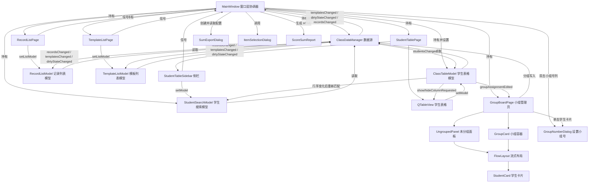
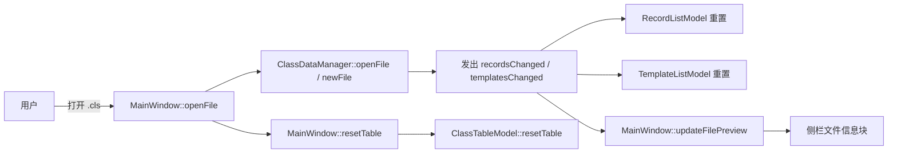
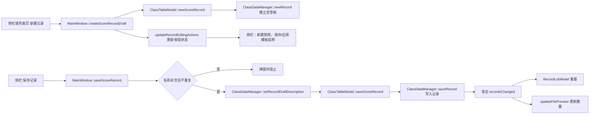
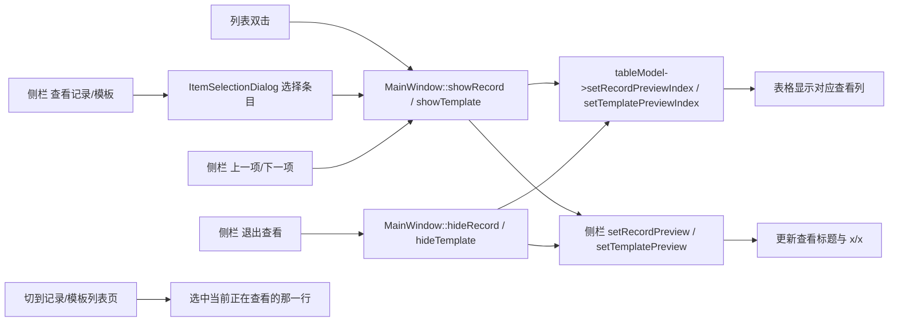
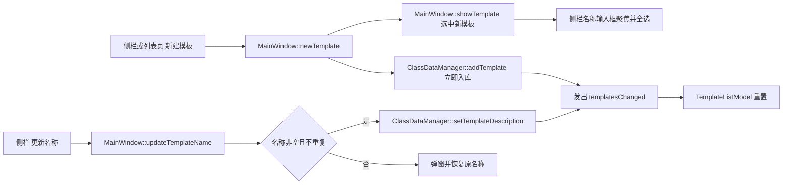
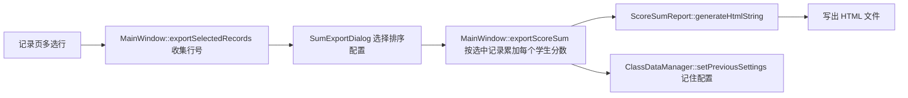
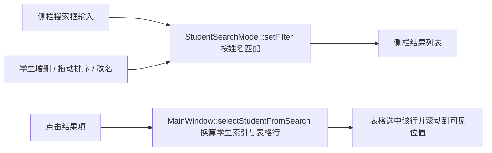
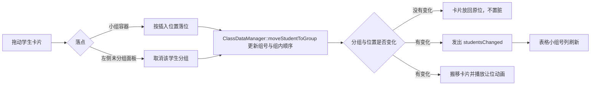
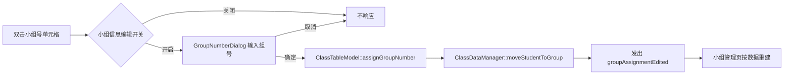

# 代码结构与数据流

## 1. 库的作用

| 库/模块 | 用途 |
|---|---|
| **Qt Core / Gui / Widgets** | 应用骨架、窗口、布局、信号槽、Model/View、拖放、对话框 |
| **FluentUI3Style** | 全局 Fluent 风格，`main.cpp` 直接 `a.setStyle(new FluentUI3Style)`，不依赖样式插件 |
| **ExWidgets** | ExWidgets 控件库；当前主要使用 `ExExpander` 实现侧栏折叠块 |
| **CMake + Ninja + MSVC x64** | 构建系统，使用 Qt 5.15.19 预设 |

## 2. 代码结构

```
src/
├── main.cpp                    # 启动入口：DPI 设置、FluentUI3Style、字体、MainWindow
├── core/                       # 数据与业务核心
│   ├── DataTypes.h             # 文件头、学生/模板/记录、排序设置及序列化
│   ├── ClassDataManager.h/.cpp # 唯一数据源：学生与分组/模板/记录/草稿/排序设置/文件读写
│   └── ScoreSumReport.h/.cpp   # 按排序设置生成积分求和 HTML 报告
├── models/                     # Qt Model/View 模型
│   ├── ClassTableModel.h/.cpp   # 学生表格：列显隐、姓名编辑开关、查看索引、拖拽排序、只读的小组号列
│   ├── RecordListModel.h/.cpp   # 积分记录列表模型：recordsChanged 后重置
│   ├── StudentSearchModel.h/.cpp# 学生搜索列表模型：按姓名匹配，结果按表格显示顺序排列
│   └── TemplateListModel.h/.cpp # 积分模板列表模型：templatesChanged 后重置
├── pages/                      # 堆叠窗口页面（只建 UI、发信号，不含业务）
│   ├── WelcomePage.h/.cpp      # 欢迎页：打开/新建两个入口卡片，使用 resources/icons 矢量图标
│   ├── StudentTablePage.h/.cpp # 班级表格页：左表格 + 右侧 StudentTableSidebar
│   ├── GroupBoardPage.h/.cpp   # 小组管理页：左未分组面板 + 右小组容器，拖放完成分组与组内排序
│   ├── StudentTableSidebar.h/.cpp # 侧栏：5 个 ExExpander；学生块内提供姓名搜索与结果跳转，记录/模板块支持查看与上下项导航
│   ├── RecordListPage.h/.cpp   # 记录列表页：顶部工具行 + 多选列表
│   └── TemplateListPage.h/.cpp # 模板列表页：顶部工具行 + 多选列表
├── delegates/                  # 表格单元格委托
│   ├── ScoreExprDelegate.h/.cpp# 积分表达式委托
│   └── TemplateSpinBoxDelegate.h/.cpp # 模板分值 SpinBox 委托
├── widgets/                    # 自绘/复用控件
│   ├── CardHost.h              # 卡片容器统一接口：插入/移除卡片、刷新标题
│   ├── CardStyle.h             # 小组管理页卡片的尺寸与配色工具
│   ├── FlowLayout.h/.cpp       # 流式布局：换行、隐藏项补位、重排位移动画、单列模式
│   ├── GroupCard.h/.cpp        # 小组容器：标题、落点高亮、插入占位槽
│   ├── HomeActionCard.h/.cpp   # 欢迎页操作卡片
│   ├── LineSpacedLabel.h/.cpp  # 可调节行距标签
│   ├── OkCancelBox.h/.cpp      # 对话框底部的确定/取消按钮组
│   ├── ShineLabel.h/.cpp       # 发光标题标签
│   ├── StudentCard.h/.cpp      # 学生胶囊卡片：悬停动效、拖动、单击改组号
│   └── UngroupedPanel.h/.cpp   # 未分组面板：单列卡片与取消分组蒙版
└── windows/                    # 主窗口与对话框（全部纯代码）
    ├── MainWindow.h/.cpp       # 窗口层协调器：文件/关于菜单，页面、侧栏与模型的信号连接
    ├── SumExportDialog.h/.cpp  # 积分导出对话框：排序配置 + OkCancelBox
    ├── GroupNumberDialog.h/.cpp # 设置小组号对话框：SpinBox + OkCancelBox
    ├── ItemSelectionDialog.h/.cpp # 列表选择入口：静态方法返回选中索引，基于 ExContentDialog
    └── AboutInfoDialog.h/.cpp  # 关于对话框
```

## 3. 架构关系图



## 4. 数据流向图

### 4.1 打开 / 新建文件



### 4.2 新建 / 保存积分记录



### 4.3 记录 / 模板查看



### 4.4 新建 / 改名积分模板



### 4.5 导出选中积分记录



### 4.6 搜索学生并跳转表格选区



### 4.7 拖放分组与组内排序



### 4.8 在表格里设置学生小组号



## 5. 状态归属

| 状态 | 归属 |
|---|---|
| 学生（含小组号与组内顺序）、模板、记录、记录草稿、排序设置、脏标记 | `ClassDataManager` |
| 当前文件名、记录/模板查看索引、小组信息编辑开关、页面会话状态 | `MainWindow` |
| 表格列显隐、行排序映射、姓名编辑开关、查看列渲染状态 | `ClassTableModel` |
| 小组容器与学生卡片的归属、拖放落点与占位状态 | `GroupBoardPage` / `GroupCard` / `UngroupedPanel` |
| 学生搜索关键字与匹配结果 | `StudentSearchModel` |
| 按钮可用性、折叠块展开状态、列表选中状态 | 各页面 / `StudentTableSidebar` |
